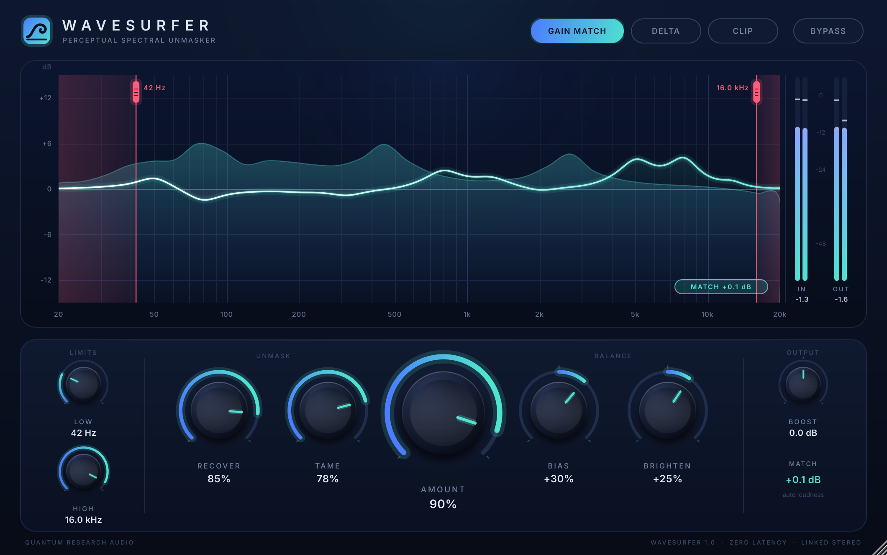

# WaveSurfer — Perceptual Spectral Unmasker

A Gullfoss-style unmasking EQ by Quantum Research Audio. It listens to the mix
through a perceptual model, cuts the frequencies that dominate (Tame) and lifts
the ones that are being masked (Recover). Zero latency, about 0.6% of one CPU core.



## Controls

| Control | Range | What it does |
|---|---|---|
| Recover | 0–100% | Lifts bands masked by their neighbours |
| Tame | 0–100% | Cuts dominant / resonant bands |
| Bias | −100…+100% | Left favours Tame, right favours Recover |
| Brighten | −100…+100% | Perceptual tilt: darker ↔ brighter |
| Amount | 0–100% | Scales the whole curve. 0% = bit-exact pass-through |
| Boost | ±12 dB | Output gain (after gain match) |
| Low / High | 20 Hz–2 kHz / 1–20 kHz | Processing limits. Also draggable red handles in the display |
| Gain Match | on/off | Holds output loudness equal to input, for honest A/B |
| Delta | on/off | Hear only what WaveSurfer changes |
| Clip | on/off | Transparent safety clipper (unity below −0.9 dBFS) |
| Bypass | on/off | Click-free, host-linked bypass |

Parameter IDs from the original SpectralUnmasker are unchanged, so old sessions load.
Brighten is now bipolar (default 0).

## Install (macOS)

Download `WaveSurfer-<version>-macOS.pkg` from **Releases** (or the latest **Actions** run) and open it.
It installs the VST3 and AU into `/Library/Audio/Plug-Ins/` and the standalone app into `/Applications`.
The build is ad-hoc signed, not notarised: if macOS blocks it, right-click the .pkg and choose **Open**.

Every push to `main` builds in GitHub Actions (`.github/workflows/build.yml`) and runs the quality checks:
the DSP stress test, a VST3 host test, and Apple's `auval -strict`. Pushing a tag such as `v1.0.0` also publishes a Release.

## Build (macOS)

```bash
git clone https://github.com/juce-framework/JUCE.git      # inside this folder, or pass -DJUCE_PATH=...
cmake -B build -G Xcode                                     # or omit -G for Makefiles
cmake --build build --config Release
```

Products land in `build/WaveSurfer_artefacts/Release/` (VST3, AU, Standalone).
The deployment target is **macOS 10.13** (High Sierra) and the binary is universal (Intel + Apple Silicon).
Xcode 27 can't target anything below macOS 12, so build on Xcode 26 or older to keep High Sierra support.

Tested against JUCE 9.0 (master, commit d60b7a7, 2026-11-02).

## Quality checks

```bash
cmake --build build --target WaveSurferStressTest && ./build/WaveSurferStressTest   # DSP, no JUCE needed
cmake -B build -DWAVESURFER_HOST_TEST=ON && cmake --build build --target WaveSurferHostTest
./build/WaveSurferHostTest_artefacts/Release/WaveSurferHostTest build/WaveSurfer_artefacts/Release/VST3/WaveSurfer.vst3
cmake -B build -DWAVESURFER_SNAPSHOT_TOOL=ON && cmake --build build --target WaveSurferSnapshot
./build/WaveSurferSnapshot_artefacts/Release/WaveSurferSnapshot ui.png 2       # render the UI to PNG
./build/WaveSurferSnapshot_artefacts/Release/WaveSurferSnapshot --editor-stress # open/close windows under load
```

## Layout

```
Source/dsp/WaveSurferDSP.h   engine (header-only, JUCE-free)
Source/PluginProcessor.*     parameters, state, host glue
Source/PluginEditor.*        window + layout
Source/ui/WaveSurferUI.h     look & feel, knobs, display, meters, logo
Tests/StressTest.cpp         extreme-level DSP checks + CPU benchmark
Tools/HostTest.cpp           loads the VST3 like a DAW
Tools/Snapshot.cpp           renders the UI / editor stress
Resources/fonts              Inter (SIL OFL 1.1, see OFL.txt)
```
